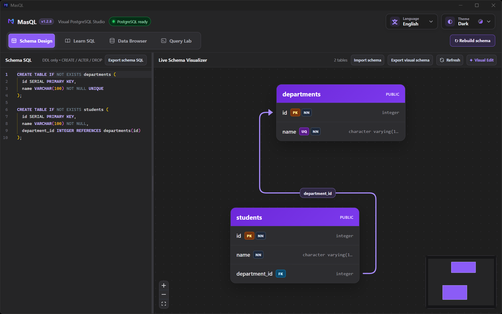

# MasQL

**See your database. Learn SQL.**

[فارسی](https://masih-roughani.github.io/masql-site/) · [English](https://masih-roughani.github.io/masql-site/en/) · [Download for Windows](https://github.com/Masih-Roughani/masql-site/releases/latest)

MasQL is a desktop PostgreSQL studio for visual schema design, SQL experimentation, and hands-on learning. It includes an embedded database, a SQL editor, schema diagrams, a data browser, visual query pipelines, and 41 learning stages with two independently graded parts each.



This public repository contains the bilingual product website, screenshots, and downloadable release assets. The desktop application's development repository is maintained separately.

## Download

Download the Windows x64 installer and its SHA-256 checksum from [Releases](https://github.com/Masih-Roughani/masql-site/releases). No GitHub account is required to download public release assets. The current installer is unsigned. Close MasQL before updating.

## گزارش مشکل و پشتیبانی

MasQL محیطی برای طراحی بصری پایگاه داده و یادگیری SQL است. برای معرفی امکانات و دریافت برنامه به [وب‌سایت فارسی](https://masih-roughani.github.io/masql-site/) مراجعه کنید.

برای گزارش خطا از [Issues](https://github.com/Masih-Roughani/masql-site/issues) استفاده کنید. نسخهٔ برنامه، نسخهٔ ویندوز و مراحل بازتولید مشکل را بنویسید. اطلاعات شخصی، گذرواژه یا داده‌های خصوصی را در گزارش عمومی قرار ندهید.

## Website development

The website uses static HTML, CSS, and progressive JavaScript, with self-hosted fonts. There are no runtime npm dependencies or added analytics.

The opening logo grows in a sticky scene as the visitor scrolls, then the product sections continue normally. Diagram connectors draw below the descriptions and screenshots gently zoom into view. Scrolling remains native, the introduction can be skipped with the keyboard, and reduced-motion preferences disable the intro runway and movement.

The build emits content-hashed CSS and JavaScript bundles so browsers receive matching assets after a website update. Generated bundles are excluded from Git and rebuilt by the deployment workflow.

```sh
npm run build
npm test
npm run verify
python -m http.server 4177
```

Open `http://localhost:4177/` for Persian or `/en/` for English. Edit translations in `scripts/content.mjs` and release metadata in `release.json`, then rebuild. GitHub Actions verifies both languages and deploys an explicit static-file allowlist to Pages on pushes to `main`.

## Publishing the next desktop version

1. Test and build the desktop application in its development repository.
2. Publish the versioned EXE and matching SHA-256 file as a release here.
3. Update `release.json`, run the build and verification, then push the website update.

Website and application license: [MIT](LICENSE). Self-hosted fonts retain their SIL Open Font License notices in `assets/fonts/`.
